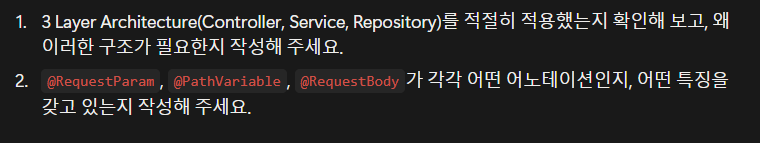

# 📅 일정 관리 앱

Spring Boot와 JPA를 활용한 일정 및 댓글 관리 REST API 구현!
- **일정 관리**: 일정 생성, 전체 조회, 단건 조회, 수정 및 삭제
- **댓글 관리**: 댓글 생성, 전체 조회, 단건 조회, 수정 및 삭제
- **데이터 관리**: Spring Data JPA를 활용한 데이터베이스 연동
- **3 Layer Architecture**: Controller, Service, Repository 계층별로 역할과 책임을 분리


프로젝트 기록: https://velog.io/@juhan913/posts

------------
###  3-Layer-Architecture 핵심 + 어노테이션



Notion 링크: https://bolder-shrimp-6f4.notion.site/Spring-6-CH-3-3f9df7a8441c8034a9f5f4447c2f130d?source=copy_link

---

## 📌 목차
- [기술 스택](#️-기술-스택)
- [API 명세서](#-api-명세서)
- [ERD](#-erd)

---

## 🛠️ 기술 스택
- Language: Java
- Framework: Spring Boot
- ORM: Spring Data JPA
- Database: MySQL
- Bulid Tool: Gradle
- API test: Postman

---


--------
## 📑 API 명세서

---


### 일정 생성(Create Schedule)

새로운 일정을 생성하는 API : 제목, 내용, 작성자, 비밀번호를 입력하면 서버에 일정이 저장되고, 생성된 일정의 상세 정보가 반환됩니다. 
비밀번호는 이후 일정 수정 및 삭제 시 본인 확인에 사용됩니다.

| 항목 | 내용                         |
|---|----------------------------|
| Method | `POST`                     |
| URL | `/schedules` |
| Content-Type | `application/json`         |
| Response Status | `201 Created`              |

**Request Body** ✅(필수) : 일정 제목(title), 일정 내용(contents), 일정 작성자(author), 비밀번호(password)

**Example Request:**
`POST /schedules/1/comments`

```json
{
  "contents": "좋은 일정이네요!",
  "author": "홍길동",
  "password": "1234"
}
```
---
### 일정 조회(Read Schedule)
#### 1. 일정 단건 조회
일정 ID를 사용하여 특정 일정의 상세 정보를 조회하는 API입니다. 
해당 일정의 제목, 내용, 작성자, 생성일, 수정일 및 댓글 목록을 반환합니다.

| 항목 | 내용 |
|---|---|
| Method | `GET` |
| URL | `/schedules/{scheduleId}` |
| Response Status | `200 OK` |

**Path Variable** ✅(필수): `scheduleId` - 조회할 일정의 ID

**Example Request:**
`GET /schedules/1`

**Example Response:**

```json
{
  "id": 1,
  "title": "Spring 공부",
  "contents": "JPA 학습하기",
  "author": "홍길동",
  "createdAt": "2026-10-14T10:00:00",
  "modifiedAt": "2026-10-14T10:00:00",
  "comments": [
    {
      "id": 1,
      "contents": "좋은 일정이네요!",
      "author": "김철수",
      "createdAt": "2026-10-14T11:00:00",
      "modifiedAt": "2026-10-14T11:00:00"
    },
    ...
  ]
}
```

#### 2. 전체 일정 조회
등록된 전체 일정을 조회하는 API입니다. 
작성자를 기준으로 조회할 수도 있으며, 작성자를 지정하지 않으면 전체 일정을 반환합니다.

| 항목 | 내용 |
|---|---|
| Method | `GET` |
| URL | `/schedules` |
| Query Parameter | `author` (선택) |
| Response Status | `200 OK` |

**Query Parameter** ❓(선택): 작성자(author)

**Example Request:**

전체 일정 조회
`GET /schedules`

특정 작성자의 일정 조회
`GET /schedules?author=홍길동`

**Example Response:**

```json
[
  {
    "id": 1,
    "title": "Spring 공부",
    "contents": "JPA 학습하기",
    "author": "홍길동",
    "createdAt": "2026-10-14T10:00:00",
    "modifiedAt": "2026-10-14T10:00:00"
  },
  {
    "id": 2,
    "title": "Spring 공부",
    "contents": "JPA 학습하기",
    "author": "홍길동",
    "createdAt": "2026-10-14T10:00:00",
    "modifiedAt": "2026-10-14T10:00:00"
  }
]
```

-------

### 일정 수정(Update Schedule)
일정 ID와 비밀번호를 사용하여 기존 일정의 정보를 수정하는 API입니다. 
비밀번호가 일치하면 일정 정보를 수정하고, 수정된 일정을 반환합니다.

| 항목 | 내용 |
|---|---|
| Method | `PUT` |
| URL | `/schedules/{scheduleId}` |
| Content-Type | `application/json` |
| Response Status | `200 OK` |

**Path Variable** ✅(필수): `scheduleId` - 수정할 일정의 ID

**Request Body** ✅(필수) : 일정 제목(title), 일정 작성자(author), 비밀번호(password)

**Example Request:**
`PUT /schedules/1`

```json
{
  "title": "Spring Boot 공부",
  "author": "홍길동",
  "password": "1234"
}
```
----------
### 일정 삭제(Delete Schedule)
일정 ID를 사용하여 기존 일정을 삭제하는 API입니다.
일정이 존재하는지 확인한 후, 해당 일정에 작성된 댓글을 먼저 삭제하고 일정을 삭제합니다.

| 항목 | 내용 |
|---|---|
| Method | `DELETE` |
| URL | `/schedules/{scheduleId}` |
| Response Status | `204 No Content` |

**Path Variable** ✅(필수): `scheduleId` - 삭제할 일정의 ID

**Example Request:**
`DELETE /schedules/1`

**Response Status Codes**

| Status Code | Description                         |
|---|-------------------------------------|
| `204 No Content` | 일정 삭제 성공 -> 응답 본문은 반환하지 않음          |
| `404 Not Found` | 해당 일정이 존재하지 않는 경우 |

----

### 댓글 생성(Create Comment)

특정 일정에 새로운 댓글을 작성하는 API입니다. URL의 `scheduleId`를 통해 댓글을 작성할 일정을 지정하고, 요청 본문에 댓글 정보를 전달합니다.

| 항목 | 내용 |
|---|---|
| Method | `POST` |
| URL | `/schedules/{scheduleId}/comments` |
| Response Status | `201 Created` |

**Path Variable** ✅(필수): `scheduleId` - 댓글을 작성할 일정의 ID

**Request Body** ✅(필수) : `contents`- 댓글 내용, `author` - 댓글 작성자, `password` - 비밀번호

**Example Request:**
`POST /schedules/1/comments`
```json
{
  "contents": "좋은 일정이네요!",
  "author": "홍길동",
  "password": "password123"
}
```
----

### 댓글 조회(Read Comments)
#### 1. 특정 일정의 댓글 조회
특정 일정 ID를 기준으로 해당 일정에 작성된 모든 댓글을 조회하는 API입니다.

| 항목 | 내용 |
|---|---|
| Method | `GET` |
| URL | `/schedules/{scheduleId}/comments` |
| Response Status | `200 OK` |

**Path Variable** ✅(필수): `scheduleId` - 댓글을 조회할 일정의 ID

**Example Request:**
`GET /schedules/1/comments`

**Example Response:**
```json
[
  {
    "id": 1,
    "scheduleId": 1,
    "contents": "좋은 일정이네요!",
    "author": "홍길동",
    "createdAt": "2026-10-14T09:00:00",
    "modifiedAt": "2026-10-14T09:00:00"
  },
  {
    "id": 2,
    "scheduleId": 1,
    "contents": "저도 동의합니다.",
    "author": "전주한",
    "createdAt": "2026-10-14T09:30:00",
    "modifiedAt": "2026-10-14T09:30:00"
  }
]
```

#### 2. 전체 댓글 조회
등록된 모든 댓글을 조회하는 API입니다.

| 항목 | 내용 |
|---|---|
| Method | `GET` |
| URL | `/comments` |
| Response Status | `200 OK` |


**Example Request:** `GET /comments`

**Example Response:**

```json
[
  {
    "id": 1,
    "scheduleId": 1,
    "contents": "좋은 일정이네요!",
    "author": "홍길동",
    "createdAt": "2026-10-14T09:00:00",
    "modifiedAt": "2026-10-14T09:00:00"
  },
  {
    "id": 2,
    "scheduleId": 2,
    "contents": "확인했습니다.",
    "author": "전주한",
    "createdAt": "2026-10-14T10:00:00",
    "modifiedAt": "2026-10-14T10:00:00"
  }
]
```

----------

### 댓글 수정(Update Comments)
특정 일정에 작성된 댓글을 수정하는 API입니다. 
URL에 일정 ID와 댓글 ID를 전달하고, 요청 본문에 수정할 댓글 정보와 비밀번호를 입력합니다.

| 항목 | 내용 |
|---|---|
| Method | `PUT` |
| URL | `/schedules/{scheduleId}/comments/{commentId}` |
| Response Status | `200 OK` |

**Path Variable** ✅(필수): `scheduleId` - 댓글이 작성된 일정의 ID, `commentId` - 수정할 댓글의 ID

**Request Body** ✅(필수) : `contents` - 수정할 댓글 내용, `author` - 수정할 댓글 작성자, `password` - 권한 확인을 위한 비밀번호

**Example Request:**
`PUT /schedules/1/comments/1`

```json
{
  "contents": "수정된 댓글입니다.",
  "author": "전주한",
  "password": "password123"
}
```
---

### 댓글 삭제(Delete Comments)

특정 일정에 작성된 댓글을 삭제하는 API입니다.
일정 ID와 댓글 ID를 사용하여 삭제할 댓글을 지정합니다.

| 항목 | 내용 |
|---|---|
| Method | `DELETE` |
| URL | `/schedules/{scheduleId}/comments/{commentId}` |
| Response Status | `204 No Content` |

**Path Variable** ✅(필수): `scheduleId` - 댓글이 작성된 일정의 ID, `commentId` - 삭제할 댓글의 ID

**Example Request:**
`DELETE /schedules/1/comments/1`

**Response Status Codes**

| Status Code | Description                |
|---|----------------------------|
| `204 No Content` | 댓글 삭제 성공 -> 응답 본문을 반환하지 않음 |
| `404 Not Found` | 해당 일정 또는 댓글이 존재하지 않는 경우    |
---


## 🗺️ ERD

